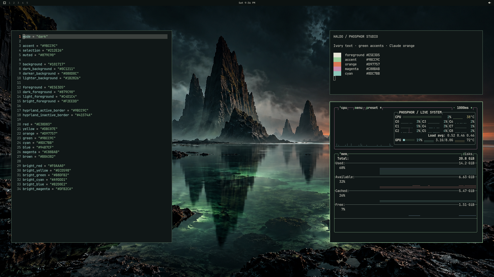
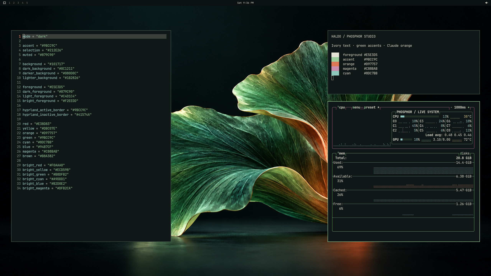

# HALDO Phosphor

**Warm theme for long workdays.** Phosphor Studio brings ivory text, phosphor
green and Claude Code orange to deep petrol-ink surfaces.


## Install

```bash
omarchy theme install https://github.com/mapski/omarchy-haldo-phosphor-theme.git
```

Select **HALDO Phosphor** from **Omarchy menu → Style → Theme**, or run:

```bash
omarchy theme set haldo-phosphor
```

Designed and checked with **Omarchy 4.0.6-1 / Quattro**. Omarchy generates
supported terminal, editor and application colors from `colors.toml`. Nine
shell sections coordinate the bar, menus, launcher, notifications, tooltips,
controls and lock screen. The shell uses 13px text and a 30px horizontal bar
while retaining your font family.

This is a theme-only package. It contains no installer, executable scripts,
test programs or workstation profile. Your widget arrangement, agent accounts,
terminal choice, shortcuts and idle policy remain yours.

## Backgrounds

**Jade Prism** is the initial background. **Ember Coast** and **Phosphor Bloom**
are included as alternatives. Open **Omarchy menu → Style → Background** to
choose one, or cycle with:

```bash
omarchy theme bg next
```

All three wallpapers ship as 3840×2160 PNGs. The artwork was AI-generated at
1672×941 and upscaled for 4K output; these are not native-detail 4K renders.

### Ember Coast



### Phosphor Bloom



## Palette

| Role | Color |
| --- | --- |
| Ink | `#101717` |
| Raised surface | `#1B2826` |
| Ivory | `#E5E3D5` |
| Phosphor green | `#9BCC9C` |
| Claude Code orange | `#D97757` |
| Magenta | `#C88BAB` |
| Error | `#E38D83` |

Screenshots are real, metadata-free 2560×1440 Wayland captures of the theme,
Foot, Neovim and btop. The sample bar arrangement demonstrates the appearance;
installing the theme does not replace your bar layout. Live system graphs are
shown without process lists, accounts or network information.

[Credits](CREDITS.md) · [MIT license](LICENSE)
