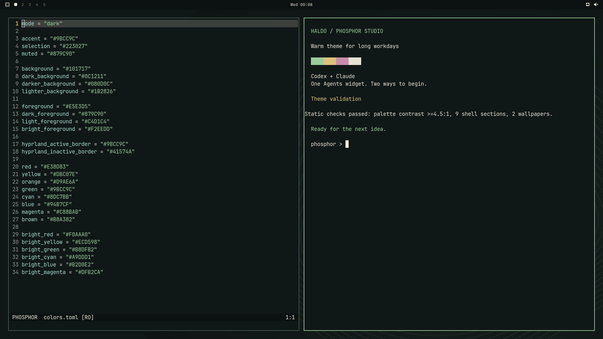

# HALDO Phosphor

**Warm theme for long workdays.** Phosphor Studio pairs petrol ink surfaces
with warm green, ivory text, amber details, and restrained magenta. Original
signal-contour wallpapers leave room for terminals, editors, and focused work.



## Install

Built and tested with **Omarchy 4.0.6-1 / Quattro**, Hyprland 0.56.2 and
Quickshell 0.3.2. Older releases may not understand the shell section settings.

```bash
omarchy theme install https://github.com/mapski/omarchy-haldo-phosphor-theme.git
```

The installed name is **HALDO Phosphor** (`haldo-phosphor`). Omarchy generates
the terminal, editor, compositor and supported agent colors from `colors.toml`.
The theme adds nine shell section overrides, including visible keyboard focus,
green selections, magenta hover, opaque panels, a 13px shell type scale, and a
30px horizontal bar. It retains your selected monospace font family.

Cycle between the two included backgrounds through Omarchy's background picker.
No third-party plugin is needed. Matrix Rain can be used separately if you
already have it; these wallpapers work on their own.

## Optional agentic workstation profile

The theme styles existing widgets. To add the agreed workstation layout,
preview the separate profile:

```bash
python3 ~/.config/omarchy/themes/haldo-phosphor/scripts/workstation.py
```

Then explicitly apply it:

```bash
python3 ~/.config/omarchy/themes/haldo-phosphor/scripts/workstation.py --apply
```

This sets a compact top bar with **one native Agents widget** and adds an
**Agents → Codex / Claude** menu. The two launch entries have equal prominence.
They appear when the corresponding CLI is installed and launch through
Omarchy's terminal helper. Install/sign in to the agents through your usual
workflow; the profile does not install them, start sessions, or change your
default agent. Each CLI retains its configured permission behavior.

The native Agents widget displays actual usage/limits and can hide when there
are no usage records. It is not a live task-status monitor. Codex and Claude
reporting are enabled, Fireworks is disabled for this profile, usage refresh
stays at 900 seconds, and cross-device sync is off. Hermes is deferred.

Unrelated settings are preserved. Bar layout is intentionally replaced by the
profile. Exact originals are backed up privately; JSONC comments are normalized
when the new menu is written. See [profile details and rollback](docs/workstation.md).

## Development

Python 3.11+ is sufficient for tests and static validation. ImageMagick is only
needed to regenerate the original wallpapers.

```bash
python3 -m unittest discover -s tests -v
python3 scripts/validate.py
python3 scripts/validate.py --native  # requires installed Omarchy
python3 scripts/build-wallpapers.py  # requires ImageMagick
```

[Design](docs/design.md) · [Validation evidence and limits](docs/validation.md) ·
[Credits](CREDITS.md) · [MIT license](LICENSE)
